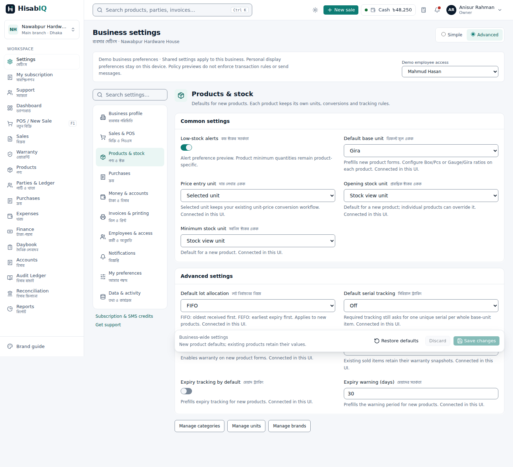
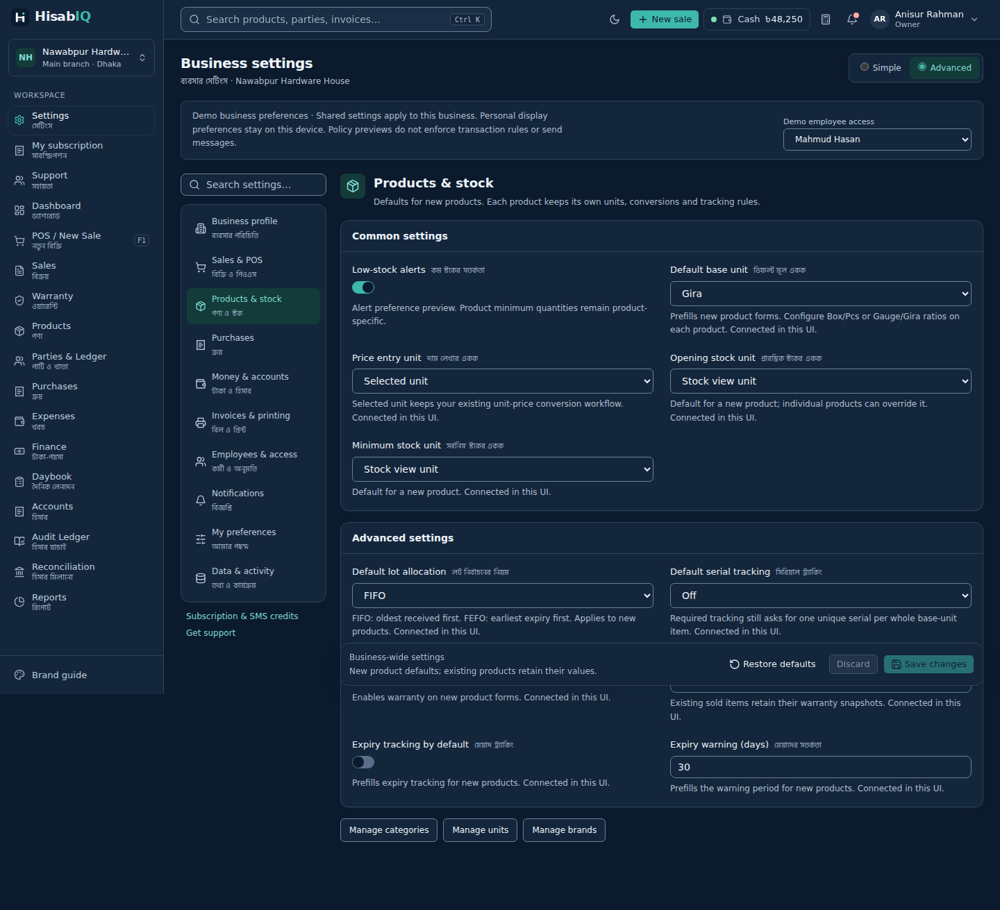
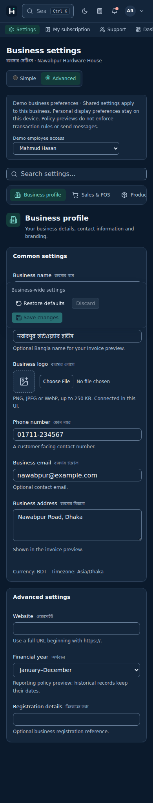

# ERP business settings

The tenant workspace now has a central Settings page at `#/app/settings/business`. It uses the existing HisabIQ components, typography, bilingual labels and theme tokens. No runtime dependencies or backend endpoints were added.

## Navigation and editing

The ten categories cover business profile, sales/POS, products/stock, purchases, money/accounts, invoices/printing, employees/access, notifications, personal preferences, and data/activity. Simple mode shows everyday choices. Advanced adds policy controls within the same categories and draft; switching modes preserves advanced values and never changes authority. Search includes Bangla labels and reveals Advanced fields when needed.

Business sections use explicit Save, Discard and Restore defaults actions. Leaving a dirty section asks whether to continue editing or discard. Changes to rounding, stock allocation, invoice prefix and posting lock date receive a review step. Uploading a logo disables Save until it has loaded. Defaults apply to new product forms; existing product unit ratios and saved warranty terms remain product-specific.

The native settings dialogs provide accessible names, modal focus containment, Escape handling and focus return. Fields have labels and descriptions, and status/error messages are announced. Secondary Bangla text uses the existing quieter helper token.

## Current connections

| Setting                                  | Current UI behavior                                                                                                                              |
| ---------------------------------------- | ------------------------------------------------------------------------------------------------------------------------------------------------ |
| Appearance                               | Shared Light/Dark/System theme, including the existing header picker                                                                             |
| Terminology and transaction date display | Existing financial labels and date presentation                                                                                                  |
| Language                                 | Settings fields and ERP navigation; other modules retain their existing translations                                                             |
| Density                                  | Compact or Comfortable table row spacing in the ERP workspace                                                                                    |
| Business identity                        | Sidebar business name and newly completed POS receipt branding                                                                                   |
| Receipt logo/footer                      | Newly completed POS receipt preview; branding is captured when the receipt completes                                                             |
| Product defaults                         | Base unit, price entry unit, opening/minimum stock unit, serial tracking, warranty duration, expiry and allocation defaults in new-product forms |
| POS defaults                             | Initial payment method and invoice rounding; compound quantities and multiple payment rows remain available                                      |
| Cash sessions                            | Header cash-session control visibility                                                                                                           |
| Employee roles                           | Combined settings permissions, editable custom roles, effective-access preview and last-owner protection                                         |
| Data                                     | Settings JSON backup/restore, settings activity, and product CSV mapping preview                                                                 |

The remaining transaction policies are saved UI configuration and review previews. Examples include discount/price/return authority, stock shortage policy, purchase approvals, backdating, financial lock dates, invoice numbering/paper/copies, and notification schedules/channels. They do not enforce transaction rules, send SMS, change financial records, or import products. Product CSV supports plain comma-separated rows without quoted fields and only previews mappings. Record links lead to existing module screens.

## Storage and permissions

The current ERP fixture is business `t1`; its settings are stored under `hisabiq-erp-settings-v1:t1`. Personal display preferences use a separate device-local key. Legacy terminology/date preferences are migrated and kept compatible. Invalid saved business data recovers to example defaults with a visible warning. Storage failures retain changes in memory and show a warning. A stale section draft cannot overwrite a newer revision received from another tab.

The Demo employee access selector is a UI review tool, not authentication. The owner fixture is Mahmud; Rafiq combines Cashier and Accountant roles, and Nusrat has Manager access. Custom settings permissions combine across roles; Advanced mode grants no extra permissions. Owners retain the protected owner role, and only owners can restore settings backups or assign owner authority. At least one active owner must remain. These business roles are separate from the SaaS administration team.

Settings backups must match the current business ID and pass structural and value validation before review. Restore replaces settings only; it does not replace invoices, stock or ledger records. The backend phase must supply the authenticated tenant/user, persist settings and activity, enforce permissions and policies on the server, and manage business master data and imports. Browser storage and demo permission checks are not a security boundary.

## Verification

- `npm test`: settings validation, scope, combined roles, atomic saves, stale revisions, owner protection and compound-unit rounding alongside existing UI helper tests.
- `npm run test:settings`: save/reload, dirty navigation, mode retention, new-product defaults, POS units/payments, combined roles, backups, CSV preview, stale tabs and storage recovery. Includes 49 rendered settings states with automated AA text contrast and label checks in Light/Dark, plus mobile overflow and Escape/focus return.
- Existing `test:theme` and `test:saas` browser journeys protect ERP and SaaS screens after the shared-shell changes.
- Production Vite build. The repository's pre-existing generated component declaration errors prevent a clean whole-project TypeScript check; new settings files have no TypeScript diagnostics.

Automated text contrast checks are useful coverage, not a full WCAG conformance audit. Screenshots below use the final default fixture.

