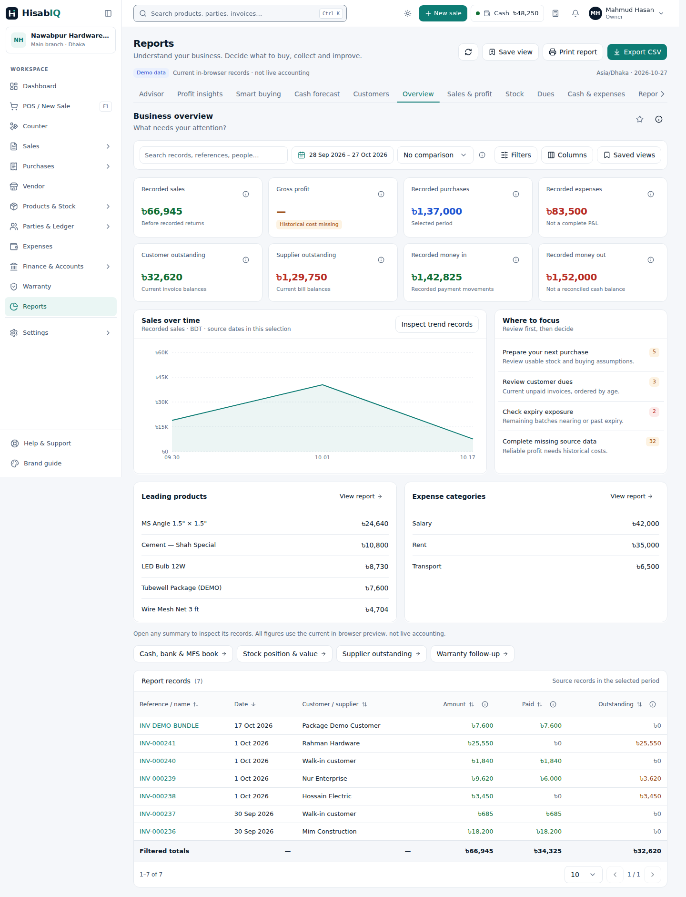
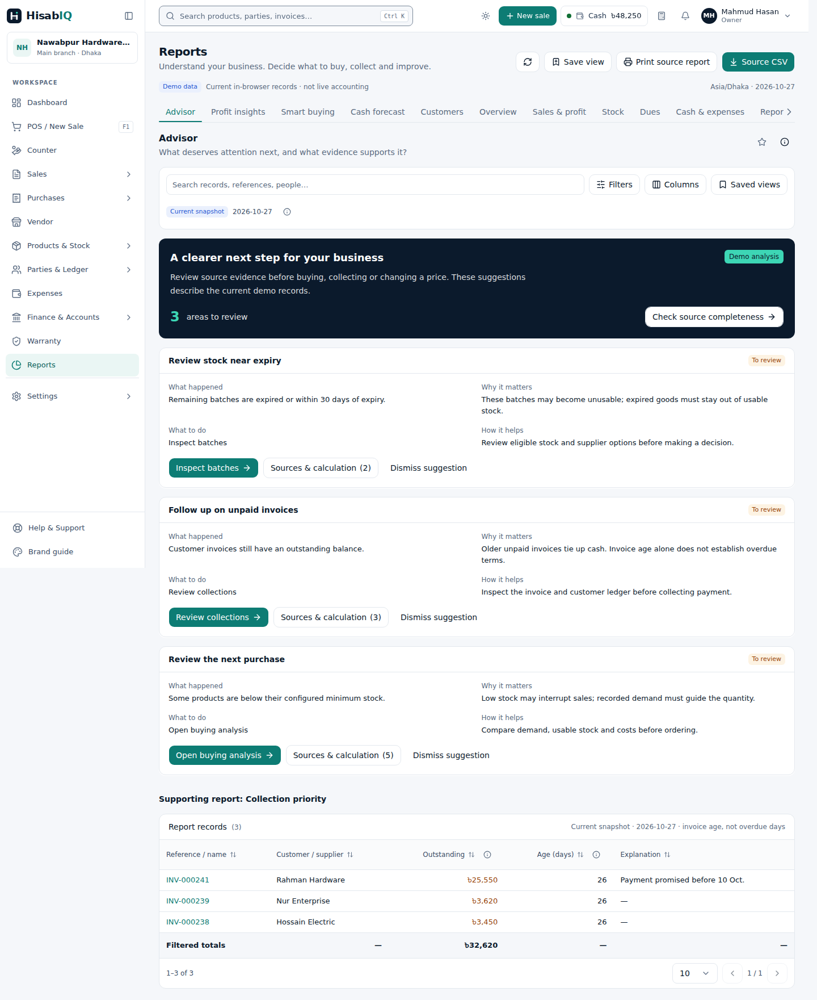

# First Reports build — review and decision record

27 October 2026. Base: `89247341`. This is the review record for the explicitly bounded [first implementation slice](2026-10-27-report-ui-first-build.md), not completion of the canonical Reports plan.

## Decisions made

- Stack implementation on open #207/#206 without merging, preserving v2.2 and the canonical plan. Cost if wrong: dependency-order/rebase work before integration.
- Use existing operational preview fixtures, with separately labeled scenario assumptions. Cost if wrong: less rich historical charts until the coherent fixture/command boundary lands.
- Supplemental analytical panels use only dimensions their sources can support. Removed dimensions are visibly stated as all accounts/products/categories/etc.; details and View all use the same declared scope. Product categories are not expense categories. Cost if wrong: users may prefer a future allocation-based view; the UI does not fabricate those allocations now.
- Treat the reviewed-state badge as evidence-specific, fixing M1 together with material lifecycle corrections. Cost if wrong: changed evidence requires another review, which is preferable to labeling unseen evidence Reviewed.

## Independent findings and corrections

| Finding | Correction | Verification |
| --- | --- | --- |
| Oversized numeric scenario input crashed Reports | Retain entered values and last valid chart; inline field-associated validation; disable save until corrected; safe paisa flows/balance | Browser pasted-large-value recovery and pure overflow regressions |
| Mismatched screen/report could label purchases as sales | One destination resolver in UI, serialization and saved-view hydration; arbitrary report only in library | URL and saved-view tests, browser metric-identity assertion |
| Cross-domain filters fabricated zero expense totals | Adapt supported dimensions per supplemental report; visible scope, consistent KPI children and View all | Pure scope regressions plus account-filtered browser evidence |
| Frozen stock base contradicted terminal chain unit | Validate terminal/base coherence before cost/quantity computation | Valid full chain/fractional case plus mismatched/unknown base rejection |
| Reviewed badge survived materially changed sources | Versioned identity for both review and dismissal | In-place purchase publication changes source evidence and resets badge in browser |
| Negative expiry days labeled as stock age | Separate Days until expiry from real stock age; bilingual signed-day explanation | Source/column regression and recaptured phone evidence |
| Checkpoint financial meaning unclear | Cumulative money-in/out, modeled closing balance and explanation | Column regression and desktop/phone verdict pass |
| Forecast lacked a visible key | Visible bars/line/dashed-buffer key with exact buffer amount | Desktop/phone verdict pass |

The independent code review found four Important issues and one Minor badge issue; all were addressed with the above regressions. It was not rerun as a second broad author-review loop. The independent Impeccable reviewer scored all three requested visual/semantic fixes **resolved**, disposition **ship**, limited to that fix list. All eight recaptures were valid. No deferred minor finding remains from those reviews.

## Explicit limits retained from independent review

Each item below was considered and retained as a scope/verification limit, not silently certified. These are the reviewer’s 22 declined judgments and the implementation decision for each.

| Review topic | Decision / scope | Cost or limitation |
| --- | --- | --- |
| Full canonical plan and 69 scenarios | Remain explicitly incomplete; this is the first reviewable UI slice. | Later integrations require their own acceptance. |
| Live Magic Patterns pixel parity | Local current v2.2 source and incumbent system remain reference; no fresh live pixel-parity claim. | A later live change may need synchronization. |
| Manual touch, screen reader, zoom and 320px reflow | Automated keyboard/touch paths and specified responsive profiles only. | Unexercised assistive/device combinations may need fixes. |
| Translation/font editorial coverage | Shared bilingual copy used; no exhaustive native editorial/font certification. | Some wording or print environments may need refinement. |
| Every chart state | Evidence tables and trend drilldown delivered; no universal chart-state certification. | Additional interactions may need targeted tests. |
| Storage failures and multi-tab durability | Browser-local preferences with warning on save failure; full concurrency matrix remains. | Preferences may differ across tabs/devices. |
| Tenant-scoped operational command boundary/reset | Deferred, with existing singleton preview stores disclosed. | This cannot serve as production tenant isolation. |
| Party observation and atomic domain projections | Purchase observation only delivered in this slice. | Other domain operations still need shared projection adapters. |
| Backend permissions, posting and reconciliation | No backend or production entitlement change. | Production integration requires separate correctness/security work. |
| Connected synthetic history/ROI | Existing preview records retained; cash assumptions are illustrative. | Some analytical charts lack sufficient historical evidence. |
| Saved supplier plans and comparison | Explicitly deferred; buying evidence, assumptions and CSV are real delivered behavior. | Downloading is not an order or saved plan. |
| PO and receipt lifecycle | Explicitly deferred. | Connected ordering/receiving cannot be claimed yet. |
| Tracked receiving/returns/corrections | Existing source restrictions retained; coherent frozen-unit validation fixed. | Tracked source allocations still need their own acceptance. |
| Exact source opening and full return context | Existing nested details retained; canonical source/return bridges deferred. | Opening a source module does not yet satisfy the full return contract. |
| Financial/price/offer/follow-up insight actions | New actions inspect evidence or existing reports; full action lifecycle remains. | These screens do not yet execute the complete decision loop. |
| Inherited accounting/report calculations | Existing engine reused; touched composition and source findings corrected. | Passing this slice does not certify all legacy domain calculations. |
| Backdated historical movement balances | Original receipts and deltas retained; full chronological reconstruction unclaimed. | Historical balance reconciliation needs separate source work. |
| General concurrency/idempotency envelope | Existing source revisions and duplicate-ID creation retained; no general command envelope claim. | Concurrent cross-domain workflows remain future work. |
| Output security audit | Shared CSV/print pipeline reused; functional output checks passed. | No separate exhaustive output security audit was performed. |
| Large dataset performance | No large-data performance benchmark. | Many derived reports/source fingerprints may need profiling at production scale. |
| Unrelated warnings/dependencies | Existing warnings recorded without broadening this feature. | They remain repository maintenance work. |
| Merge/deployment/product acceptance | Draft implementation PR only; no merge or production deployment. | The user still reviews the concrete first build before integration. |

## Review captures

[All eight captures](qa-2026-10-27/) show desktop light, tablet Bangla, and phone dark Bangla states. The scored fixes are visible in Stock and Cash forecast. These are screenshots of the running implementation, not generated mockups.

